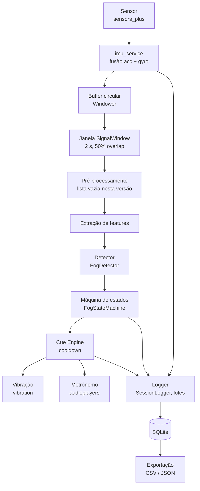
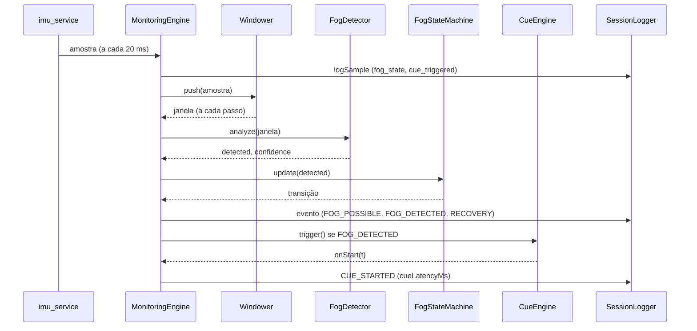
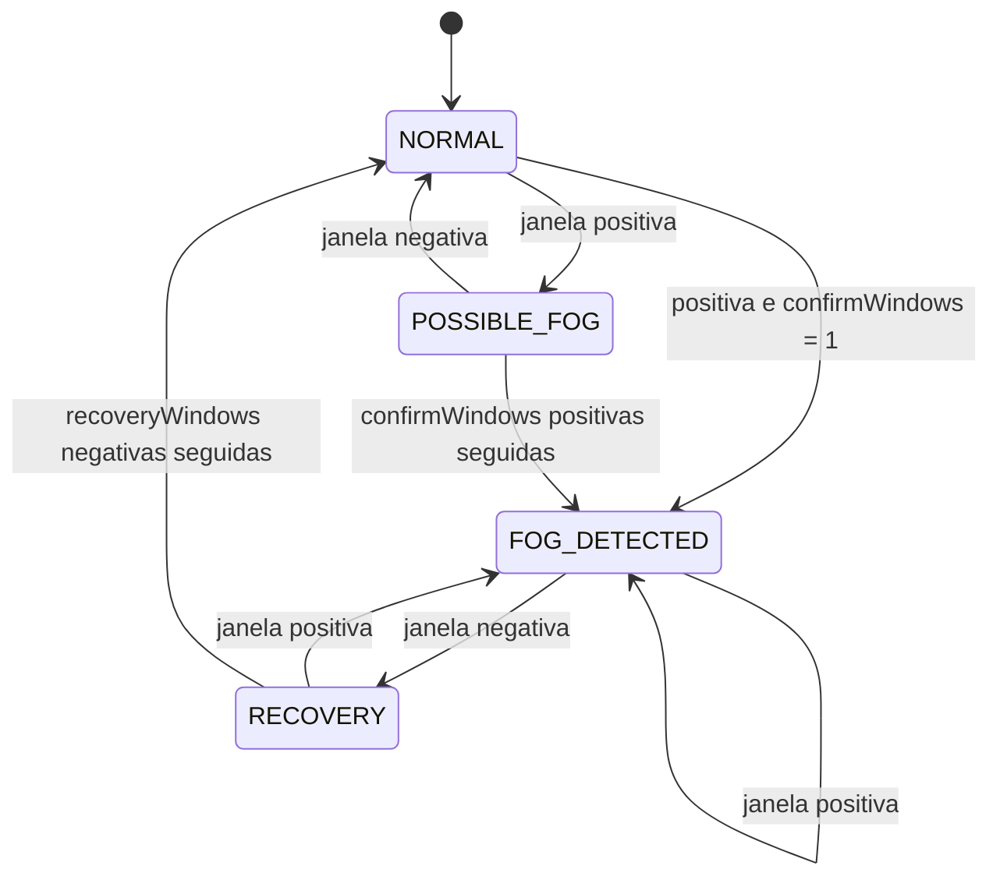

# Arquitetura

## Visão geral

O `MonitoringEngine` (`lib/monitoring/monitoring_engine.dart`) é o único
lugar que conhece todas as peças. Cada peça só conhece seus dados de entrada
e saída, o que permite testá-las isoladamente e trocar uma sem mexer nas
outras.

## Camadas

| Camada | Pasta | Depende de plataforma? |
| --- | --- | --- |
| Tipos, relógio e configuração | `core/`, `config/` | não |
| Sinal (buffer, janelas, features) | `signal/` | não |
| Detecção e máquina de estados | `fog/` | não |
| Cue Engine (lógica) | `cues/` | não (saídas injetadas) |
| Sessões, logger, CSV | `sessions/` | não (destino injetado) |
| Orquestração | `monitoring/` | não (dependências injetadas) |
| Serviços nativos | `services/` | sim |
| Interface | `screens/`, `ui/` | sim |

Tudo que não depende de plataforma é testado em `test/`, incluindo um teste
de integração que passa sinal sintético (parado, agitado, parado) pela
pipeline inteira com relógio falso (`fake_async`).

## Sequência de uma detecção

## Máquina de estados

"Simular FoG" chama `force()`, que leva qualquer estado a FOG_DETECTED e
segue o mesmo caminho de eventos e cue de uma detecção real (com
`simulated: true` no evento).

- `confirmWindows` reduz falsos positivos isolados.
- `recoveryWindows` é a histerese de saída do episódio.
- A duração do episódio (FOG_DETECTED até RECOVERY) vai no evento RECOVERY.
- Enquanto o estado for FOG_DETECTED, cada janela tenta disparar o cue; o
  Cue Engine recusa se já houver um tocando ou se o cooldown não passou.

## Tempo e latência

- No Android, o `sensors_plus` converte o tempo do evento do sensor
  (monotônico, desde o boot) para a escala do relógio do sistema. Intervalos
  entre amostras vêm do sensor; os valores são comparáveis com
  `DateTime.now()`.
- `processingLatency = detectionTimestamp - sensorWindowEndTimestamp`
- `cueLatency = cueStartTimestamp - sensorWindowEndTimestamp`
- Ajustes no relógio do sistema durante a sessão afetam as latências
  absolutas. Para comparar algoritmos no mesmo aparelho a medida basta; para
  valores absolutos será preciso um método externo (ex.: filmagem em alta
  velocidade).
- Se o detector ainda estiver ocupado quando a próxima janela chegar, a nova
  janela é descartada e contada em `windowsSkipped`, em vez de acumular atraso.

## Persistência

SQLite (`fogcue.db`), tabelas:

- `sessions`: uma linha por sessão; `metadata` guarda em JSON os parâmetros
  do experimento (taxa, janela, detector e versão, cue, versão do app).
- `samples`: mesmas colunas do CSV de amostras.
- `events`: `timestamp`, `type`, `metadata` (JSON).
- `settings`: configurações experimentais salvas.

O `SessionLogger` acumula em memória e grava a cada 1 s ou a cada 250
amostras, em lote dentro de uma transação. As escritas são serializadas, e
um lote que falha volta para a fila.

## Como adicionar um detector

1. Criar uma classe em `lib/fog/` que implemente `FogDetector` (`name`,
   `version`, `analyze(window)`), síncrona ou assíncrona.
2. Adicionar o valor em `DetectorName` (`lib/config/experiment.dart`) e um
   caso em `createDetector` (`lib/fog/detectors.dart`).
3. Se precisar de novas features, criar um `FeatureExtractor` em
   `lib/signal/features.dart` e reproduzir a mesma definição em Python, para
   que treino e inferência calculem exatamente o mesmo vetor.

Fluxo previsto: app coleta, CSV vai para Python, modelo é treinado e
exportado (coeficientes em JSON para modelos lineares e árvores, ou TFLite
para redes), e um novo detector carrega esse modelo e roda no aparelho.
